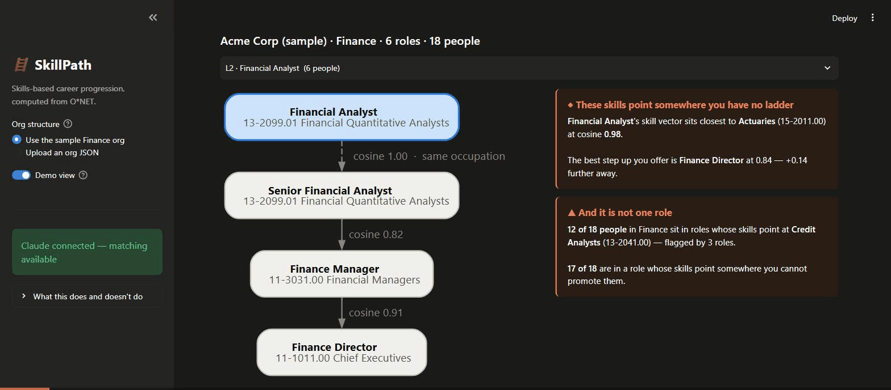

# SkillPath — Phases 0–7 (complete)

A skills-based career-progression mapper for HR. This repo contains every phase
from §9 of the spec:

| Phase | What it is | Where |
|---|---|---|
| **0** | Data + math spine — O*NET → SQLite, vectors, cosine similarity, skill gaps | `src/onet_loader.py`, `src/vectors.py` |
| **1** | Org handling — sample org JSON, loader, validator, the `reports_to` walk | `orgs/`, `src/org.py` |
| **2** | Title→SOC matching — deterministic shortlist, Claude picks from it | `src/matching.py` |
| **3** | Adjacency engine — rank senior roles, build the skill-natural ladder, recommend | `src/engine.py` |
| **4** | Streamlit front end | `app.py` |
| **5** | **Org-vs-skill divergence flag** — the differentiator | `src/divergence.py` |
| **6** | **Team-level drift view** — the same flag across the whole function, weighted by headcount | `src/team.py` |
| **7** | **Demo view** — the one screen that sells it (spec §10) | `app.py` |

Give it a role and it returns a skill-natural progression ladder with concrete
development recommendations at each rung — then tells you where that ladder
disagrees with your org chart, and where your people's skills point that you have
no ladder for at all. Then it does the same across every role at once and counts
the people behind each answer, so the finding is a function-level one rather than
six separate anecdotes.

## The demo

The spec's §10 money shot: one screen, no scrolling — pick a role, the skill-natural
ladder appears, and the callout says *these people's skills point somewhere you have no
ladder for*.



`streamlit run app.py`, then flip **Demo view** in the sidebar. It opens on the role with
the most people behind an actual finding — a rule, not a hardcode, so an uploaded org
also opens on its own strongest case. On the sample org that is Financial Analyst: six
people whose closest match in the whole economy is *Actuaries* at cosine 0.98, against a
best offered step up of 0.84. Underneath, the function-level line: **12 of 18 people**
point at a track this org has no ladder for.

Everything else — the org table, the O\*NET matching, the per-step recommendations, the
export — is one toggle away in the full view.

---

## Design notes

The theme lives in `.streamlit/config.toml`; the few things Streamlit has no setting
for (the callout cards, the ladder diagram) are tokenised at the top of `app.py`.

**Light and dark are selected, not flipped.** Each mode's colours are stepped for its
own surface — `#fcfcfb` and `#1a1a19` — and every text-on-tint pair clears 4.5:1 in
both. The cards read the viewer's *active* theme via `st.context.theme`, so they follow
a manual theme switch rather than the OS setting.

**Colour does exactly one job each.**

| | |
|---|---|
| **Blue** | identity and interaction — focus, selection, and the "you are here" rung. Never means good or bad. |
| **Orange** | the gap we found. Sub-3:1 on the light surface *by design*, so it never carries meaning alone: every card pairs it with an icon and a heading, and light-mode heading ink drops to a darker step of the same hue (`#c2410c`, 4.67:1 on its tint). |
| **Green** | reserved for the genuinely healthy case — no divergence. |
| **Red** | reserved for validation errors, and used nowhere else. A missing ladder is an opportunity, not a failure, so findings are never red. |

**The ladder's rungs are not a ramp.** The starting rung takes the accent tint; every
rung above it is neutral. The rungs are a *path*, not a magnitude — colouring them on a
scale would encode something the data does not say. Distance is carried by the cosine on
each edge, which is the number that actually measures it.

Graphviz has no media queries, so the diagram gets **one** palette that has to read on
both surfaces: light node fills with near-black ink, and `#898781` — the one muted ink
that is mode-invariant — for every edge and edge label (3.50:1 on light, 4.85:1 on dark).
Its `fontname` is a single family Graphviz has metrics for, not a CSS stack: layout sizes
each node from those metrics while the browser renders the resolved font, so a stack it
cannot measure produces labels that spill past their boxes.

*Palette source: the validated default in Claude's `dataviz` skill. Its categorical CVD
gates were not re-run here — there is no series palette in this app, only an accent plus
two reserved status colours — but every colour/surface pair above was contrast-checked.*

---

Phases 0, 1, 3, 5 and 6 are **pure Python and fully deterministic** — no LLM touches a
number. Claude appears only in `src/matching.py`, where it picks a SOC code from a
locally generated shortlist and narrates the result; it can never invent a code
(`_validate_pick` rejects anything off the shortlist) and never computes an
adjacency score.

---

## What's here

**Phase 0 — data + math spine**

1. Downloads the **O*NET 30.3** tab-delimited text database.
2. Loads the pieces the math needs into a local SQLite DB at `./data/onet.db`:
   - **Occupation Data** — SOC code, title, description.
   - **Skills** — see the note below on the 30.3 restructure.
   - **Knowledge**.

   Rows O*NET flags `Recommend Suppress = Y` are **dropped** — those are estimates
   O*NET considers too unreliable to publish. That is ~5,027 rows (4.1%), almost all
   of them near-zero Level scores on descriptors irrelevant to the occupation
   (99.6% are `LV`; 97.6% are below 2.0 on the 0–7 scale). The loader reports the
   count and stores it in `meta.n_suppressed_rows`.
3. Core functions (`src/vectors.py`):
   - `build_vector(soc_code)` — the role's 68-dim skill vector, `value = LV × IM` per descriptor.
   - `similarity(soc_a, soc_b)` — cosine similarity between two role vectors (0–1).
   - `skill_gap(soc_current, soc_next)` — top-5 trainable descriptors, by `LV_next − LV_current`.
   - `skill_gap_split(soc_current, soc_next)` — the same deltas, **split into Skills and Knowledge**.
   - `is_rated(soc_code)` — does this SOC have a vector at all? (see the unrated-SOC note below).

**Phase 1 — org handling** (`src/org.py`)

- `load_org(path)` — parse an org JSON (§5 schema) into `Org` / `Role` dataclasses.
- `validate_org(org, conn)` — checks the org against itself *and* against O*NET: duplicate
  ids, dangling or cyclic `reports_to`, no single root, out-of-range levels, and SOC codes
  that are unknown or **unrated**. Returns a list of `error`/`warning` issues rather than
  raising on the first, so the UI can show them all at once.
- `org_path(org, role_id)` — the naive walk up `reports_to` to the root. This is the *org*
  ladder; the engine computes the *skill* ladder; Phase 5's divergence flag is the difference.
- `senior_roles` / `next_level_roles` — candidate pools for the engine.

**Phase 3 — the adjacency engine** (`src/engine.py`)

- `rank_candidates(org, role_id, conn, pool=None)` — more-senior roles scored by cosine
  similarity, smallest jump first. `pool` overrides the default so Phase 5 can rank against
  occupations the org has no ladder for; `rank_socs` does the same for raw SOC codes.
- `next_role(org, role_id, conn)` — the single natural next role, restricted to the nearest
  occupied level above so the ladder advances one rung at a time.
- `build_ladder(org, role_id, conn)` — walks to the top, attaching `skill_gap_split`
  recommendations to every step.
- `format_ladder(ladder)` — renders it in the spec §7 style.

**Phase 5 — the divergence flag** (`src/divergence.py`)

The consulting-grade feature. Phases 0–4 show the ladder that already exists; this
surfaces the ladder that *should*, in two forms:

- `off_ladder_matches(org, role_id, conn, top_n=5)` — O*NET occupations whose skill
  profile sits **closer to this role than anything the org offers as a step up**.
  On the sample org, Financial Analyst's closest match in the whole economy is
  **Actuaries (`15-2011.00`) at cosine 0.98**, followed by Economists, Business
  Intelligence Analysts and Statisticians — an entire quantitative track this
  finance org has no ladder for.
- `path_divergence(org, role_id, conn)` — the rung the org chart says is next
  (follow `reports_to`) versus the senior role that is genuinely the smallest skill
  jump. On the sample org they disagree: the chart sends the analyst to Finance
  Manager (0.82), but Finance Director (0.84) is the smaller jump.
- `divergence(...)` combines both; `format_divergence(...)` renders the §7 callout.

Two decisions worth knowing, both documented at length in the module docstring:

1. **The threshold is relative, not an absolute cosine.** The spec's worked example
   flags "cosine 0.85", but because every vector entry is a non-negative LV × IM
   product, cosine over real occupations is compressed into a narrow high band —
   against the analyst, the median of all 894 rated occupations is 0.74 and the
   95th percentile is 0.86. A fixed 0.85 would flag a twentieth of the economy.
   The baseline is instead *the best step up the org itself offers*, which is
   self-calibrating and states the finding in the terms an HR reader cares about.
2. **No job-zone / seniority filter.** O*NET's Job Zone looks like a seniority
   proxy and isn't one. Filtering to "zone ≥ the current role's" drops Actuaries,
   Business Intelligence Analysts and Credit Analysts while keeping Astronomers,
   Physicists and Postsecondary Teachers. Ranking by skill adjacency does the job
   better. (This was tested before it was rejected.)

Same-occupation rungs are excluded from the baseline: Senior Financial Analyst
shares the analyst's SOC and scores exactly 1.0, so counting it would make the
baseline unbeatable and silence the flag permanently. `tests/validate_divergence.py`
CHECK 2 is the regression guard for exactly that.

**Phase 6 — the team-level drift view** (`src/team.py`)

Phase 5 answers the question for one role. Phase 6 asks it of the whole function and
counts the people behind the answer:

- `role_drifts(org, conn)` — runs the Phase 5 divergence for every role, carrying the
  ones it cannot assess (unrated SOC, or the top of the ladder) with an explicit
  `reason` rather than dropping them, so the table still adds up to the org.
- `missing_ladders(drifts)` — groups every role's off-ladder matches by destination
  occupation and sums the headcount behind each. **On the sample org, 12 of 18 people
  sit in roles pointing at Credit Analysts (`13-2041.00`) and Budget Analysts
  (`13-2031.00`) — flagged by three roles each — with Actuaries, Economists and
  Business Intelligence Analysts behind them at 9 people.** 17 of 18 people are in a
  role whose skills point somewhere this org cannot promote them.
- `team_drift(...)` combines both; `format_team_drift(...)` renders the callout.

Two decisions worth knowing, both documented at length in the module docstring:

1. **Headcount aggregates, margin does not.** Each role's margin is measured against
   *its own* baseline — the best step up that particular role is offered — so a clerk's
   `+0.06` and an analyst's `+0.14` are fractions of different denominators, and summing
   them across roles quietly mixes scales. Headcount has no such problem, so it is the
   number the view leads with and the key destinations are ranked by. There is
   deliberately **no composite "drift index"**, for the same reason Phase 5 refused the
   spec's absolute 0.85 threshold.
2. **Ranking by people, not by cosine, changes the headline.** Actuaries is the single
   closest off-ladder occupation in the whole economy (0.976) but only two roles point at
   it; Credit Analysts is slightly further (0.971) and three roles point at it. The
   department-level answer is the one more people are standing behind, so Credit Analysts
   leads. Both are in the table.

Roles are scanned at `per_role_top_n=10` before aggregation but only the top 5
destinations are displayed — a destination sitting 6th for three separate roles is a
bigger finding than one sitting 1st for a single role, and a top-5 scan would hide it.

**Validation:** `tests/validate.py` (Phase 0 math), `tests/validate_org.py` (Phases 1 + 3),
`tests/validate_matching.py` (the deterministic half of Phases 2 + 4 — no API calls),
`tests/validate_divergence.py` (Phase 5), and `tests/validate_team.py` (Phase 6).
`build.py` runs all five.

---

## Quick start

```bash
# 1. Create the environment (Python 3.11) and install deps
conda create -n skillpath python=3.11 -y
conda activate skillpath
pip install -r requirements.txt

# 2. One command: build data/onet.db from scratch AND run the validation
python build.py
```

`python build.py` downloads the O*NET zip (only if `data/db_30_3_text.zip` is missing),
rebuilds `data/onet.db` from scratch, then runs the validation script. Use
`python build.py --force-download` to re-fetch the O*NET zip.

> On this machine the interpreter lives at
> `C:\Users\Rafaf\anaconda3\envs\skillpath\python.exe` — you can run
> `"C:\Users\Rafaf\anaconda3\envs\skillpath\python.exe" build.py` directly instead of
> activating the env.

### Expected output (validation)

`build.py` runs **all five** suites and exits `0` only if every assertion in every one passes.

*Phase 0 — `tests/validate.py`*
- **CHECK 1 (assertion):** `similarity(Financial Analyst, Financial Managers)` >
  `similarity(Financial Analyst, Chefs & Head Cooks)`.
- **CHECK 2:** top-5 `skill_gap` for Financial Analyst → Financial Managers.
- **CHECK 3:** a similarity matrix across five finance-related roles.

*Phases 1 + 3 — `tests/validate_org.py`*
- **CHECK 1 (assertion):** the sample org loads with zero blocking issues and every SOC is rated.
- **CHECK 2 (assertion):** `org_path("fin-analyst")` == `fin-analyst → fin-mgr → fin-director`.
- **CHECK 3 (assertion):** the candidate ranking is well-formed — sorted descending, the
  same-SOC rung sits first at exactly `1.0000`, and every senior finance role scores above
  an unrelated control (Cooks, Restaurant `35-2014.00`). Whether the org's own rung order
  matches skill distance is **reported, not asserted** — on the sample org it does *not*
  (`sim(analyst, director) 0.8376` > `sim(analyst, mgr) 0.8210`), which is the org-vs-skill
  divergence Phase 5 exists to surface rather than something to assert away.
- **CHECK 4 (assertion):** the ladder tops out at `fin-director` and **every** step recommends
  both a skill and a knowledge area.
- **CHECK 5 (assertion):** the same-SOC step is flagged and borrows its recommendations.

The ladder is printed in full, so the validation run doubles as the demo output.

*Phases 2 + 4 — `tests/validate_matching.py`* (**no API calls** — runs without a key)
- **CHECKS 1–2 (assertions):** the keyword shortlist contains the plausible codes and the
  known-bad searches (`Accounts Payable Clerk`, `Staff Accountant`) resolve correctly.
- **CHECK 3 (assertion):** every shortlisted occupation is **rated** — the guard that stops
  an unrated SOC ever reaching `build_vector()`.
- **CHECK 4 (assertion):** a hallucinated SOC is replaced by the top keyword hit, confidence
  is downgraded, the user is warned, **and a hallucinated runner-up is cleared too**.
- **CHECK 5 (assertion):** `ladder_dot` emits one node per rung and one edge per step.

*Phase 5 — `tests/validate_divergence.py`*
- **CHECK 1 (assertion):** the analyst flags off-ladder occupations — every one outside the
  org, ranked, each with a positive margin over the org's best step up.
- **CHECK 2 (assertion):** the baseline ignores same-occupation rungs. The regression guard:
  counting Senior Financial Analyst (cosine 1.0) would silence the flag forever.
- **CHECK 3 (assertion):** detail codes of an occupation the org *has* are excluded —
  `11-3031.01` Treasurers is not a missing ladder when the org has `11-3031.00`.
- **CHECK 4 (assertion):** path divergence is detected and its margin is positive.
- **CHECK 5 (assertion):** the top of the ladder flags nothing rather than crashing (no
  senior roles ⇒ no baseline ⇒ the comparison would have no meaning).
- **CHECK 6 (assertion):** repeated calls are byte-identical.

The run ends by printing the §7 callout in full, so it doubles as the demo output.

*Phase 6 — `tests/validate_team.py`*
- **CHECK 1 (assertion):** every role appears exactly once and `people_total` equals the
  org's own headcount sum (18) — the view accounts for the whole function, not just the
  roles it can assess.
- **CHECK 2 (assertion):** the aggregation converges — at least one missing ladder is
  backed by more than one role, and its headcount is exactly the sum over those roles.
  Without this the view is only Phase 5 printed six times.
- **CHECK 3 (assertion):** the broad-SOC exclusion survives aggregation — no occupation
  the org already has a role for is reported as a missing ladder.
- **CHECK 4 (assertion):** the top of the ladder is carried as unassessable **with a
  reason**, counts toward `people_total`, and contributes nothing to `people_exposed`.
  The regression guard against silently dropping roles the math cannot speak to.
- **CHECK 5 (assertion):** the totals are coherent — `0 ≤ exposed ≤ total`, no ladder
  claims more people than the function has, every margin beats its own baseline.
- **CHECK 6 (assertion):** repeated calls, and the rendered callout, are byte-identical.

The run ends by printing the department callout in full, so it too doubles as demo output.

> **Data note — the "Financial Analyst" code.** The spec's headline role is
> O*NET **13-2051.00** (Financial and Investment Analysts), but **O*NET 30.3 publishes
> no skill/knowledge ratings for that code** (122 of 1016 occupations are unrated;
> collection for this merged occupation is still pending), so it has no vector. The
> validation stands in the closest rated financial-analyst occupation,
> **13-2099.01 Financial Quantitative Analysts**. `build_vector()` on an unrated code
> raises a clear `ValueError` rather than returning a misleading zero vector — later
> phases must expect some SOC codes to be unrated.

---

## Repo structure

```
skillpath/
├── .streamlit/
│   └── config.toml       # the theme: light + dark, each selected for its own surface
├── build.py              # one-command: build onet.db + run ALL FIVE validation suites
├── app.py                # Phases 4, 6 + 7: the Streamlit front end (incl. demo view)
├── demo/
│   └── skillpath-demo.gif    # the §10 money shot, recorded
├── requirements.txt      # numpy, scikit-learn, anthropic, streamlit
├── data/                 # O*NET zip + onet.db  (git-ignored, regenerated)
├── orgs/
│   └── sample_finance.json   # the sample Finance org (hand-authored input)
├── src/
│   ├── onet_loader.py    # re-runnable loader: download -> SQLite
│   ├── vectors.py        # build_vector / similarity / skill_gap(_split)  (no LLM)
│   ├── org.py            # Phase 1: load / validate / walk the org chart
│   ├── matching.py       # Phase 2: title -> SOC  (the ONLY module that calls an LLM)
│   ├── engine.py         # Phase 3: rank candidates, build the ladder, recommend
│   ├── divergence.py     # Phase 5: off-ladder matches + org-vs-skill path divergence
│   └── team.py           # Phase 6: the same flag across the org, weighted by headcount
└── tests/
    ├── validate.py            # Phase 0: sanity checks on known transitions
    ├── validate_org.py        # Phases 1 + 3: org, ladder and recommendation checks
    ├── validate_matching.py   # Phases 2 + 4: shortlist, guards, DOT  (no API calls)
    ├── validate_divergence.py # Phase 5: the divergence flag
    └── validate_team.py       # Phase 6: the team-level drift view
```

---

## Note: the O*NET 30.3 "Skills" restructure

The spec assumed a single `Skills.txt`. **O*NET 30.3 split the old ~35-descriptor Skills
content model into two files:** `Essential Skills` (element IDs `2.A.*`) and
`Transferable Skills` (`2.B.*`). Together they **are** the spec's ~35 skills, and both
still carry the **Importance (IM)** and **Level (LV)** scores the vector math relies on.
So the loader reads **four** source files instead of three (Skills is split in two).

`Software Skills` is **deliberately excluded**: it carries no IM/LV scores (only
`Hot Technology` / `In Demand` Y/N flags), so it does not fit the `LV × IM` model.

Resulting descriptor space:

| Group | O*NET 30.3 file(s) | Element IDs | Count |
|-------|--------------------|-------------|-------|
| Skills | `Essential Skills` + `Transferable Skills` | `2.A.*` + `2.B.*` | 10 + 25 = **35** |
| Knowledge | `Knowledge` | `2.C.*` | **33** |
| **Vector** | | | **68 dims** |

This matches the spec's "~35 Skills + ~33 Knowledge ≈ 68 dimensions" exactly.

**Abilities are excluded** (per the spec — they are closer to innate aptitudes than
trainable skills); they are never loaded, so `skill_gap` returns Skills + Knowledge only.

---

## The org file

The tool's only user-supplied input (spec §5). `orgs/sample_finance.json` is the worked
example, and it is `load_org()`'s default path — call `load_org()` with no argument to get it.

```json
{
  "company": "Acme Corp (sample)",
  "function": "Finance",
  "roles": [
    {
      "role_id": "fin-analyst",
      "title": "Financial Analyst",
      "level": 2,
      "reports_to": "fin-mgr",
      "headcount": 6,
      "onet_soc": "13-2099.01",
      "description": "Builds models, analyzes financial statements, supports budgeting."
    }
  ]
}
```

`role_id`, `title` and `level` are required; the rest are optional. **Level scale:**
1 = entry, 2 = analyst, 3 = senior, 4 = manager, 5 = director. Exactly one role must have
`reports_to: null` — that's the root.

`onet_soc` would normally be filled in by the Phase 2 matching step. Since Phase 2 isn't
built, the sample org has it pre-filled:

| role_id | title | lvl | onet_soc |
|---|---|---|---|
| `fin-clerk` | Accounts Payable Clerk | 1 | `43-3031.00` Bookkeeping, Accounting & Auditing Clerks |
| `fin-analyst` | Financial Analyst | 2 | `13-2099.01` Financial Quantitative Analysts |
| `fin-accountant` | Staff Accountant | 2 | `13-2011.00` Accountants and Auditors |
| `fin-sr-analyst` | Senior Financial Analyst | 3 | `13-2099.01` *(same as analyst — deliberate)* |
| `fin-mgr` | Finance Manager | 4 | `11-3031.00` Financial Managers |
| `fin-director` | Finance Director | 5 | `11-1011.00` Chief Executives |

There is deliberately **no** consulting/analytics rung — and Phase 5 duly surfaces it. The
gap turns out to be wider than the spec's example guessed: the analyst's closest match in
all of O*NET is Actuaries (0.98), with Economists, Business Intelligence Analysts and
Statisticians behind it, all far above anything this org offers as a step up.

Phase 6 then shows the gap is not one role's problem. Three of the six roles — Staff
Accountant, Financial Analyst and Senior Financial Analyst, **12 of the org's 18 people** —
point at the same missing credit/budget-analytics track, and 17 of 18 people sit in a role
whose skills point somewhere this org has no ladder for. One role pointing off-ladder is an
anecdote; twelve people converging on one missing occupation is an org-design finding.

---

## Two design decisions worth knowing

### 1. Recommendations are split into Skills and Knowledge

Ranking one blended list by raw Level delta lets Knowledge sweep the board. Analyst →
Financial Manager returns **five Knowledge areas and zero Skills** — technically correct,
but it buries exactly the trainable skills an HR reader is looking for. `skill_gap_split`
ranks the two types independently, so both always surface:

```
-> develop (skills):    Management of Personnel Resources, Monitoring, Negotiation
-> develop (knowledge): Administrative, Customer and Personal Service, Education and Training
```

Those three skills are the ones the spec's §7 example predicted; the blended list hid them.
`skill_gap` is untouched and still returns the single ranked list.

### 2. Two rungs can share one O*NET occupation

Financial Analyst and Senior Financial Analyst are both *Financial Quantitative Analysts* —
and that is the **correct** mapping, not a data-entry slip. But an identical SOC means an
identical vector, so cosine is exactly `1.00` and the element-wise gap is **empty**. (The
spec has this latent bug: its own §5 sample maps both rungs to `13-2051.00`, which makes the
"cosine 0.97" in §7 impossible from that data.)

Rather than fudge the vector by org level — which would stop the adjacency being O*NET-derived —
such a step is reported honestly:

```
Financial Analyst  (13-2099.01 Financial Quantitative Analysts)
      |  cosine 1.000  same occupation
      v
Senior Financial Analyst  (13-2099.01 Financial Quantitative Analysts)
   note: same O*NET occupation - a depth/scope progression, so O*NET reports no skill
         delta; recommendations below are the run-up to Finance Manager, the next rung
         that maps to a different occupation
```

The step carries `same_occupation=True` and `recommendations_from="fin-mgr"`, so a
substituted recommendation is always visible rather than silent.

---

## Known limitations

- **O*NET is US-centric.** Fine for a proof-of-concept; a Guatemala/LatAm deployment would
  need local occupational data or a custom skills layer.
- **122 of 1016 occupations are unrated** — including the spec's headline `13-2051.00`.
  `is_rated()` exists precisely so callers can check before computing; `validate_org` treats
  an unrated SOC as a blocking error.
- **Broad SOC codes leak irrelevant descriptors.** O*NET has no "Finance Director"
  occupation, so the sample org maps it to `11-1011.00` Chief Executives, whose ratings span
  every industry. Its top Knowledge delta comes out as *Engineering and Technology* — an
  artifact of that breadth, not finance-career advice. A tighter title→SOC match (Phase 2)
  reduces this but cannot eliminate it.
- **No constraints modeling** (budget, geography, or whether a headcount can actually move).
  Phase 6 counts headcount to size a finding, not to model a constraint: it says how many
  people are behind a missing ladder, never whether you can afford to build one. The skill
  path is aspirational, the org path is real, and the gap between them is the insight.
- **Cross-role margins are not comparable.** Each role's margin is relative to its own best
  step up, so Phase 6 aggregates on headcount and deliberately publishes no composite
  "drift score". See the `src/team.py` docstring.

---

## The math (for reviewers)

- **Vector:** for each of the 68 descriptors, `value = Level (LV) × Importance (IM)`.
  Missing descriptors (or a descriptor missing either scale) contribute `0`.
- **Adjacency:** cosine similarity between two role vectors. Because all entries are
  non-negative, cosine is bounded to `[0, 1]`.
- **Skill gap:** element-wise `LV_next − LV_current` (raw Level, **not** weighted by IM),
  keep positive deltas, sort descending. `skill_gap` takes the top 5 overall;
  `skill_gap_split` takes the top 3 Skills and top 3 Knowledge separately.
- **Ladder:** from the starting role, step to the highest-similarity role at the nearest
  occupied level above, and repeat to the top. One rung at a time, so the walk cannot leap
  straight to the most-similar director.

---

## Data attribution

This product includes information from the **O*NET 30.3 Database** by the
U.S. Department of Labor, Employment and Training Administration (USDOL/ETA).
Used under the **CC BY 4.0** license. O*NET® is a trademark of USDOL/ETA.

- License: https://creativecommons.org/licenses/by/4.0/
- Source: https://www.onetcenter.org/database.html

**Modifications made:** a subset of the database (Occupation Data, Essential Skills,
Transferable Skills, Knowledge) was extracted and reshaped into a local SQLite database
and into per-role numeric vectors for similarity and gap analysis.
